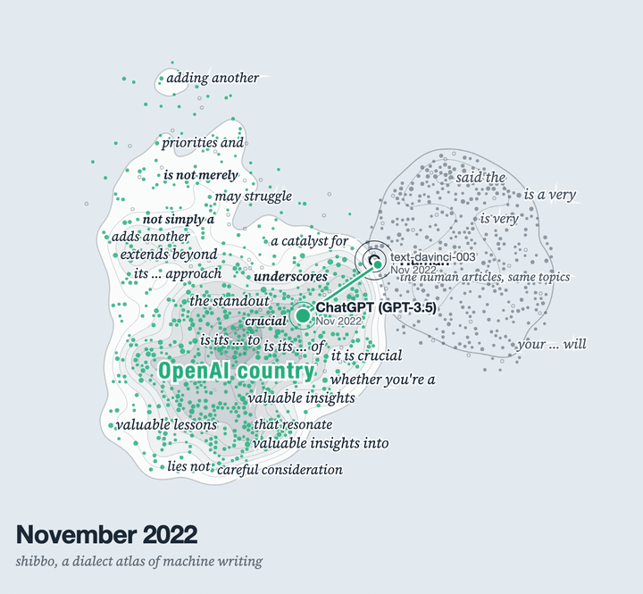
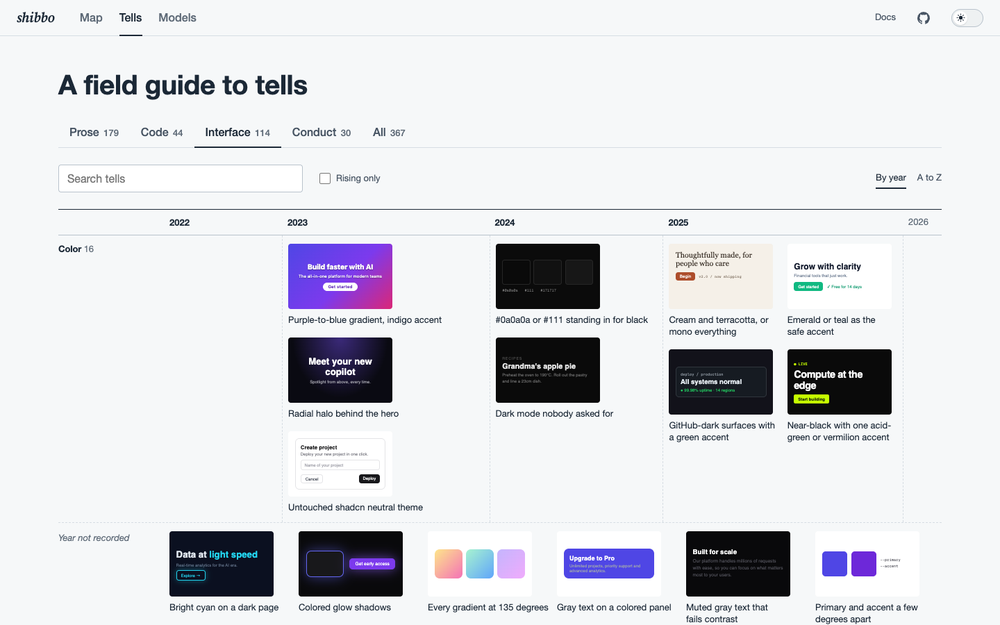
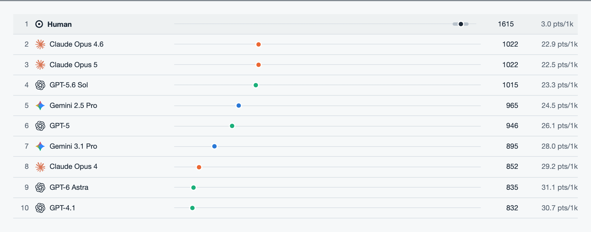

<h1 align="center"><i>shibbo</i></h1>

<p align="center">
  <b>Catch what gives AI work away, before anyone else does.</b><br>
  A field guide to AI tells, with prose tells measured model by model and a checker for your own work.
</p>

<p align="center">
  <a href="#quick-start">Quick start</a> ·
  <a href="#what-it-checks">What it checks</a> ·
  <a href="#the-atlas">The atlas</a> ·
  <a href="docs/guide/quick-start.md">Docs</a> ·
  <a href="#contributing">Contributing</a>
</p>

<p align="center">
<picture>
  <source media="(prefers-color-scheme: dark)" srcset="https://raw.githubusercontent.com/xvr2e7/shibbo/main/.github/assets/atlas-dark.gif">
  
</picture>
</p>

People have learned to spot AI work: a stock phrase in an essay, say, or a purple gradient on a landing page. Once they spot one, they trust the rest less.

<!-- shibbo-ignore -->
These tells shift with each release. In 2024, "delve" gave away GPT-4; today most models use it no more than people do, and some never do. Newer models have their own habits, such as Claude Opus 5's "genuinely useful" and GPT-6 Astra's "rather than treating", which people writing on the same topics never used. A list of tells from last year misses them.
<!-- /shibbo-ignore -->

Shibbo tracks each tell over time and measures which models over-use it. Run it on your work to see which ones show up.

Shibbo gathers the tells that earlier studies, lists and checkers found into one registry, and credits each source. See [Prior art](#prior-art).

The name comes from *shibboleth*: a small sign, like a word said wrong, that gives away where someone comes from.

## Quick start

```console
$ npx shibbo check draft.md --model gpt-6
draft.md: 20/100 [heavy] (29 words)
  1:1      high sycophantic-opener       "Great question"
                → Start with the answer.
  1:33     med  delve                    "delve"
                → Say what you will do ("look at", "compare", "list").
  1:44     med  x-matters                "why the distinction matters"
                → Show what goes wrong without it. Readers will see that it matters.
  3:4      high contrastive-negation     "is not a tool, it is"
                → State the real claim. Keep a contrast only when someone holds the other view.
  3:36     med  corrective-rather-than   "Rather than treating"
                → Say what to do. Skip the straw version.
```

Each hit comes with a fix. `--model` weights the score toward the phrases that model over-uses, and `--threshold 80` fails a CI run when a file scores lower.

To catch tells while an agent works, set up its harness:

```bash
npx shibbo init <harness>
```

This adds shibbo's rules and its MCP tool to the harness. It works with Claude Code, Codex, Cursor, Copilot, Gemini CLI, Devin, Cline, Roo, Aider, Kiro, Junie, Amp, opencode, Goose, Zed, Continue and Warp. In Claude Code, Codex, Gemini CLI, Cline, Aider and Amp, the agent also hears about tells after each edit. Cursor, Copilot, Devin and Kiro have experimental hooks; the [support table](docs/harnesses/index.md) has the details.

## What it checks

| Files | Tells |
|---|---|
| Markdown, text | Stock phrases and "not X, it's Y" frames |
| HTML, SVG | Prose tells in the visible text; interface tells in the markup |
| CSS, Sass, Less | Purple gradients, or Inter set everywhere |
| JSX, TSX, Vue, Svelte, Astro | Interface and code tells |
| JS, TS, Python, Go, Rust, … | Comments that narrate the edit, or tests skipped to go green |

Agent tells, such as "All tests pass" without running them, happen during the work, so no file shows them. Shibbo puts the top ones in the agent's rules instead. Tells that need human judgment show up as questions: `check --all` and the MCP server list them.

## The atlas

The web app maps how machine writing has shifted with each release, on a timeline that cites every date back to 1966. Run it with `npm run web:dev`.

<table>
<tr>
<td width="50%">
<picture>
  <source media="(prefers-color-scheme: dark)" srcset="https://raw.githubusercontent.com/xvr2e7/shibbo/main/.github/assets/tells-dark.png">
  
</picture>
<p><b>Tells.</b> Every tell, sorted by kind of work. Each card shows the tell itself, so an interface tell appears as a small mockup.</p>
</td>
<td width="50%">
<picture>
  <source media="(prefers-color-scheme: dark)" srcset="https://raw.githubusercontent.com/xvr2e7/shibbo/main/.github/assets/arena-dark.png">
  
</picture>
<p><b>Arena.</b> Humans and models write on the same topics, and the article with fewer tells wins each round. Humans lead, as expected, since a tell is something models write more often than people.</p>
</td>
</tr>
</table>

## Prior art

Many people have catalogued AI tells before, each for one kind of work: prose, interfaces or code. Shibbo aims to be one source of truth across all of them. It brings their findings together, checks them against measured data where that exists, and keeps a citation and a date on every entry. The registry cites more than a hundred sources, including:

<!-- shibbo-ignore -->
| Kind | Examples |
|---|---|
| Measured studies | Graphite's [AI Tells](https://graphite.io/research/ai-tells), [Kobak et al.](https://www.ncbi.nlm.nih.gov/pmc/articles/PMC12219543/) on "delves" in PubMed, [Why does ChatGPT "delve" so much?](https://aclanthology.org/2025.coling-main.426/), [Antislop](https://arxiv.org/abs/2510.15061) |
| Community lists | Wikipedia's [Signs of AI writing](https://en.wikipedia.org/wiki/Wikipedia:Signs_of_AI_writing), [AI writing tropes](https://gist.github.com/ossa-ma/f3baa9d25154c33095e22272c631f5a1) |
| Checkers and skills | [avoid-ai-writing](https://github.com/conorbronsdon/avoid-ai-writing), [Slop Guard](https://eric-tramel.github.io/blog/2026-02-18-slop-guard), [slop-score](https://github.com/sam-paech/slop-score), [deslop](https://github.com/dabit3/deslop), [avoid-ai-design](https://github.com/funboy322/avoid-ai-design), [no-slop-ui](https://github.com/LeoStehlik/no-slop-ui), [Hallmark](https://github.com/Nutlope/hallmark) |
| Agent reports | Bug reports from the Claude Code, Codex and Gemini CLI issue trackers, and published agent system prompts |
<!-- /shibbo-ignore -->

[Sources](docs/concepts/sources.md) lists every one.

Other catalogs cover parts of this ground, among them [aismells](https://aismells.pages.dev/ai-writing-tells.html) for prose, [ai-design-tells](https://pypi.org/project/ai-design-tells/) for interfaces, and the [anti-slop skill](https://lobehub.com/skills/rand-cc-polymath-anti-slop) across text, code and design. As far as we know, none of them pairs prose, code, interface and agent tells with per-model measurements and a source on every entry. If you know one that does, or a source we missed, please [open an issue](https://github.com/xvr2e7/shibbo/issues).

## The data

<!-- shibbo-ignore -->
| Tell | Earlier models | Newest models |
|---|---|---|
| "delves" | PubMed abstracts, 2024: 28× the rate expected from earlier years (Kobak et al.) | Web articles on the same topics: people 6 uses; GPT-5.6, GPT-6, Opus 4.6 and Opus 5 at most 2 each; Gemini 3.1 Pro 18 |
| Em dashes | GPT-4.1 2.3× the human rate, GPT-5 2.2× | GPT-6 Astra 0.12×, Claude Opus 5 0.93×, Gemini 3.1 almost none |
| "not a _, it is" | | Claude Opus 5: 445 uses, people 1 |
| "that distinction matters" | | GPT-6 Astra: 564 uses, people 0 |
| "it's" | | people: 14,540 uses, Claude Opus 4.6: 7 |
<!-- /shibbo-ignore -->

Models and people still share most of their words. On the same topics, 70 to 78% of each model's word use matches people's, and 52 to 65% of its two-word phrases. The atlas draws only phrases one side uses at least 4× as often, in 150 or more articles.

The PubMed figure compares 2024 abstracts with the rate earlier years predict, with no human baseline. The rest compare models with people writing web articles on the same topics. Graphite asked for plain text, and em dash rates shift with the prompt. Graphite's second dash count puts Claude Opus 5 at 3.5×.

Shibbo measures each model against people writing on the same topics. The data comes from Graphite's [AI Tells](https://graphite.io/research/ai-tells) study for 2025–26 models, and from shibbo's own runs on [RAID](https://github.com/liamdugan/raid) for 2022–23 instruct and chat models. Measurements of open-weight models are under way in [`measure/`](measure/).

To test the checker, shibbo scores a person's article and a model's article on the same topic, across topics it never trained on, and counts how often the model's scores worse. The curated rules were written after reading all of Graphite's data, so the results run somewhat high. [The data docs](docs/concepts/data.md) have the latest results and their limits.

## Contributing

Each tell is a YAML entry in `data/tells.yaml` or `data/tells.d/`, with a fix and at least one source. The guides cover [adding a tell](docs/guide/add-a-tell.md) and [measuring a new model](docs/guide/measure.md).

```bash
npm install
npm test && npm run validate
npm run web:dev
```

## Credits

Most measurements come from Graphite's "AI Tells" (2026, CC BY 4.0); its article texts belong to their publishers and stay out of the repo. The PubMed figures come from [Kobak et al.](https://arxiv.org/abs/2406.07016) (2025). Every other source is listed in [`data/sources.yaml`](data/sources.yaml). The code is MIT-licensed, and the data keeps each source's license.
